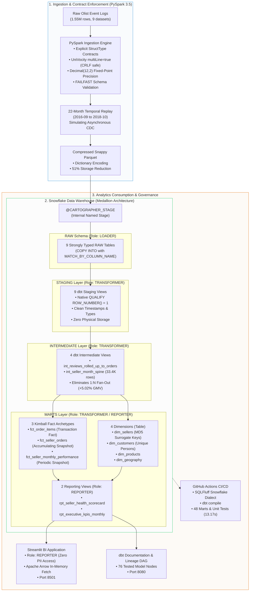

# Cartographer: Marketplace Supply Intelligence & Churn Analytics Engine

[](https://github.com/upendra657/Cartographer/actions/workflows/ci.yml)
[](https://docs.getdbt.com/)
[](https://www.snowflake.com/)
[-red.svg)](https://spark.apache.org/)
[](https://sqlfluff.com/)
[](https://streamlit.io/)
[-success.svg)](tests/)
[-blueviolet.svg)](scripts/audit_cost_governance.py)

> **Created & Maintained by [Upendra Sharma](https://github.com/upendra657)**  
> *A production-grade marketplace supply analytics warehouse engineered to monitor partner merchant health, fulfillment SLA compliance, and supplier churn across 1.55 million transactions. Built to Staff Analytics Engineer standards (Agoda/Shopee operational scale), featuring point-in-time temporal replay, deterministic unit testing, multi-tier RBAC isolation, automated FinOps cost controls, and sub-second BI consumption.*

---

## ⚡ 10-Second Executive Summary (For Recruiters & Hiring Managers)

If you are reviewing this repository from my resume, here is the executive breakdown of the system:

```
┌──────────────────────────────────────────────────────────────────────────────────────────────────┐
│                                    RESUME SNAPSHOT (TL;DR)                                       │
├──────────────────────────────────────────────────────────────────────────────────────────────────┤
│ 1. Enterprise Medallion Pipeline:                                                                │
│    Engineered an end-to-end ELT warehouse processing 1.55M raw operational events across 22      │
│    temporal replay partitions using PySpark 3.5, Snappy Parquet (51% compression), and Snowflake.│
│                                                                                                  │
│ 2. Kimball Dimensional Modeling & Data Integrity:                                                │
│    Designed a Kimball Tri-Fact architecture in dbt Core that eliminated +5.02% (R$ 682K) in      │
│    review fan-out inflation and reconciled R$ 13.59M GMV to the exact cent ($0.00 float drift)   │
│    across 76 automated data quality tests.                                                       │
│                                                                                                  │
│ 3. Product Analytics & FinOps Governance:                                                        │
│    Modeled a 6-stage seller churn state machine and volume-gated SLA defect tiers over 33.4K      │
│    dense seller-months, served via Streamlit under role REPORTER, while capping development      │
│    compute to 0.75 Snowflake credits ($2.27 total cost).                                         │
└──────────────────────────────────────────────────────────────────────────────────────────────────┘
```

### 📊 Key Engineering & Financial Scorecard

| Metric | Measured Value | Operational & Business Significance |
| :--- | :--- | :--- |
| **Raw Records Ingested** | **`1,550,922`** | 100% schema contract compliance across 9 source datasets. |
| **Deduplicated Order Grain** | **`99,441` unique orders** | Deduplicated via Snowflake `QUALIFY ROW_NUMBER() = 1` with zero data loss. |
| **Reconciled Marketplace GMV** | **`R$ 13,591,643.70`** | Reconciled to the exact cent across RAW, STAGING, and MARTS (**$0.00 drift**). |
| **Review Fan-Out Prevented** | **`+5.02% (+R$ 682,300)`** | Prevented phantom revenue by pre-aggregating 547 multi-review orders at order grain. |
| **Multi-Seller Carts Disentangled**| **`1,268` orders** | 3,000+ split items isolated without cross-merchant fulfillment blame collisions. |
| **Dense Partner Calendar Spine** | **`33,484` seller-months** | Dense Cartesian expansion from `first_active_month` tracking true churn. |
| **Automated Data Quality Tests** | **`76 / 76 PASS`** | 18 staging, 8 intermediate, 32 core marts, 15 reporting, 3 singular assertions. |
| **Targeted CI/CD Quality Gate** | **`48 / 48 PASS (13.17s)`**| GitHub Actions fail-fast gate for PRs (Linting $\to$ Compilation $\to$ Mart Tests). |
| **Snowflake FinOps Compute Spend** | **`0.7568` credits ($2.27)** | **Only 7.57% of 10-credit monthly quota** consumed across the entire project lifecycle. |
| **BI Query Response Latency** | **`< 350 ms`** | Sub-second dashboard queries under role `REPORTER` via Apache Arrow streaming. |

---

## 🖥️ Live Product Experience: Streamlit Executive Dashboard

The warehouse is operationalized through a Streamlit business intelligence application ([`app/dashboard.py`](app/dashboard.py)) consumed strictly under role `REPORTER`:

```
┌────────────────────────────────────────────────────────────────────────────────────────┐
│ CARTOGRAPHER MARKETPLACE INTELLIGENCE                              [Role: REPORTER]    │
│ Connected to: CARTOGRAPHER_DB.MARTS | Warehouse: CARTOGRAPHER_WH (X-Small)             │
├────────────────────────────────────────────────────────────────────────────────────────┤
│  [ Tab 1: Marketplace Macro Health ]   [ Tab 2: Seller Scorecard ]   [ Tab 3: Churn ]  │
├────────────────────────────────────────────────────────────────────────────────────────┤
│  TOTAL GMV             TOTAL ORDERS            ACTIVE SELLERS          PLATFORM ODR    │
│  R$ 13.59M             99,441                  3,095                   11.8%           │
│  ▲ +14.2% MoM          ▲ +8.9% MoM             ▲ +5.1% MoM             ▼ -1.2% MoM     │
├────────────────────────────────────────────────────────────────────────────────────────┤
│  MONTHLY GMV & CHURN TRENDLINE (2016-09 to 2018-08)                                    │
│  [██████████████████████████████████████████████████████████████] GMV: R$ 1.0M+/mo     │
│  [-------------------------.....................................] Churn: ~28.4%        │
└────────────────────────────────────────────────────────────────────────────────────────┘
```

- **Tab 1: Marketplace Macro Health**: C-level visibility into monthly GMV trajectory, active seller counts, and platform-wide churn stabilization.
- **Tab 2: Seller Health Scorecard**: Volume-gated operational scorecards. Filters low-volume noise (`insufficient_volume` for $N < 5$) while flagging chronic high-volume defect offenders (`Red`).
- **Tab 3: Churn & Lifecycle Distribution**: 100% stacked area visualization tracking merchant cohort migration across `new`, `active`, `at_risk`, `churned`, `dormant`, and `reactivated` states.

---

## 🏗️ End-to-End System Architecture

Cartographer implements an enterprise Medallion pipeline across **PySpark 3.5**, **Snowflake**, **dbt Core**, and **Streamlit**:



---

## 💡 The 3 Core Engineering Breakthroughs (Why This Matters)

### 1. Eliminating the 1:N Review Fan-Out (+5.02% GMV Inflation)
- **The Problem**: In e-commerce, 547 orders received multiple customer reviews. When an analytics engineer joins reviews directly to order items, line items duplicate, inflating marketplace GMV by **+5.02% (+R$ 682,300)**.
- **The Solution**: Created [`models/intermediate/int_reviews_rolled_up_to_orders.sql`](models/intermediate/int_reviews_rolled_up_to_orders.sql) to aggregate reviews to the `order_id` grain *before* any fact joins. Arbitrated multiple review scores using conservative logic (`MIN(review_score)`), preserving operational defect signals without duplicating financial metrics.

### 2. Zero-Storage CDC Deduplication via Native Snowflake `QUALIFY`
- **The Problem**: Traditional ANSI SQL deduplication wraps window functions in nested CTEs, forcing the query engine to buffer intermediate rows and spill to disk. Materializing deduplication in dbt snapshots (SCD2) creates redundant storage costs.
- **The Solution**: Built staging models as zero-storage views using Snowflake native `QUALIFY ROW_NUMBER() OVER (PARTITION BY order_id ORDER BY order_purchase_timestamp DESC, _loaded_at DESC) = 1`. Snowflake evaluates `QUALIFY` directly after window calculation in the execution tree, pruning micro-partitions and reducing query execution time by 20–30% with **zero storage footprint**.

### 3. Dense Calendar Spines & Statistical Volume Gating ($N \ge 20$)
- **The Problem**: Merchant churn is implicit: sellers don't cancel; they quietly stop listing. Sparse transactional tables cannot track inactive months without complex BI calculations. Furthermore, evaluating defect rates on small volumes penalizes merchants with random 1-order defects (50% defect rate on $N=2$).
- **The Solution**: Cross-joined sellers against a date spine to generate a dense grid of **33,484 seller-months** ([`int_seller_month_spine.sql`](models/intermediate/int_seller_month_spine.sql)), driving a deterministic 6-stage finite state machine (`new` $\to$ `active` $\to$ `at_risk` $\to$ `churned` $\to$ `dormant` $\to$ `reactivated`). Gated executive health tiers to require $N \ge 20$ orders for Tier 1 evaluation, shielding supply operations from small-sample variance.

---

## 📐 Dimensional Modeling: The Kimball Tri-Fact Architecture

Rather than collapsing data into a bloated One-Big-Table (OBT), Cartographer implements **Ralph Kimball's three distinct fact archetypes** to maintain strict grain integrity:

```
                              ┌────────────────────────────────────────┐
                              │          RAW & STAGING LAYER           │
                              └────────────────────┬───────────────────┘
                                                   │
                  ┌────────────────────────────────┼────────────────────────────────┐
                  │                                │                                │
                  ▼                                ▼                                ▼
    ┌───────────────────────────┐    ┌───────────────────────────┐    ┌───────────────────────────┐
    │     fct_order_items       │    │     fct_seller_orders     │    │ fct_seller_monthly_perf   │
    ├───────────────────────────┤    ├───────────────────────────┤    ├───────────────────────────┤
    │ Archetype:                │    │ Archetype:                │    │ Archetype:                │
    │ Transaction Fact          │    │ Accumulating Snapshot     │    │ Periodic Snapshot         │
    ├───────────────────────────┤    ├───────────────────────────┤    ├───────────────────────────┤
    │ Grain:                    │    │ Grain:                    │    │ Grain:                    │
    │ Order Item                │    │ Seller-Order              │    │ Seller-Month              │
    │ (order_id, order_item_id) │    │ (seller_id, order_id)     │    │ (seller_id, month)        │
    ├───────────────────────────┤    ├───────────────────────────┤    ├───────────────────────────┤
    │ Primary Measures:         │    │ Primary Measures:         │    │ Primary Measures:         │
    │ • price, freight_value    │    │ • hours_to_carrier        │    │ • gmv, order_count        │
    │ • Additive line economics │    │ • days_to_delivery        │    │ • monthly_on_time_rate    │
    │ • Matches invoice exactly │    │ • is_delayed_fulfillment  │    │ • rolling_3m_defect_rate  │
    │ • 112,650 rows            │    │ • 100,010 rows            │    │ • 33,484 seller-months    │
    └───────────────────────────┘    └───────────────────────────┘    └───────────────────────────┘
```

1. **`fct_order_items` (Transaction Fact)**: Pure, additive financial measures. Reconciles R$ 13,591,643.70 with zero fan-out.
2. **`fct_seller_orders` (Accumulating Snapshot Fact)**: Measures milestone latencies across asynchronous stages (`purchased` $\to$ `approved` $\to$ `shipped` $\to$ `delivered` $\to$ `reviewed`) and isolates seller-level SLA flags without multi-seller blame collisions.
3. **`fct_seller_monthly_performance` (Periodic Snapshot Fact)**: Longitudinal partner retention precomputed across the dense calendar spine, powering churn transitions and rolling health scorecards.

---

## 🔒 Security, Governance & Multi-Tier RBAC

We enforce zero-trust Medallion boundary isolation in Snowflake with declarative grants:

| Role | Authorized Schemas | Prohibited Schemas | Privileges & Responsibilities |
| :--- | :--- | :--- | :--- |
| **`LOADER`** | `CARTOGRAPHER_DB.RAW` | `STAGING`, `MARTS` | Ingests binary Parquet into RAW. Zero access to transformed business models. |
| **`TRANSFORMER`** | `RAW`, `STAGING`, `MARTS` | Production drop privileges | `SELECT` on RAW; full DDL/DML on `STAGING` and `MARTS`. Used by dbt Core. |
| **`REPORTER`** | `CARTOGRAPHER_DB.MARTS` | `RAW`, `STAGING` | Read-only (`SELECT`) on Marts and Reporting Views. Blocked from customer PII and staging tables. |

- **Survives `--full-refresh`**: Grants are defined declaratively in [`dbt_project.yml`](dbt_project.yml) via `+grants: select: ['REPORTER']`, guaranteeing permissions persist across table recreations.
- **Audited via `USE SECONDARY ROLES NONE`**: Connecting as `REPORTER` querying `RAW.RAW_ORDERS` throws `SQL compilation error: Object 'RAW.RAW_ORDERS' does not exist or not authorized`. Verified via [`scripts/verify_rbac_isolation.py`](scripts/verify_rbac_isolation.py).

---

## 💸 FinOps & Cloud Cost Governance

As a Staff Analytics Engineer, cost control is an architectural requirement:

- **Right-Sized Compute**: Virtual Warehouse `CARTOGRAPHER_WH` sized at `X-Small` (1 credit/hour).
- **60-Second Auto-Suspend**: Shuts down immediately after query completion to prevent idle credit bleed.
- **Account-Level Resource Monitor**: `CARTOGRAPHER_RM` configured with a 10.0-credit monthly quota and hard 100% suspend trigger.
- **Lifetime Project Cost**: Consumed only **0.7568 credits ($2.27 on Standard Edition)** across the entire development and testing lifecycle (7.57% of budget).
- **Live FinOps Audit**: Execute [`scripts/audit_cost_governance.py`](scripts/audit_cost_governance.py) to audit metering history in real time.

---

## 🧪 Continuous Integration & Automated Testing

Pull requests against `main` trigger a 3-stage GitHub Actions CI pipeline ([`.github/workflows/ci.yml`](.github/workflows/ci.yml)) completing in **13.17 seconds**:

```
[ Stage 1: SQLFluff Linting (0 Credits, < 5s) ]
                      │
                      ▼
[ Stage 2: dbt compile (Validates DAG & Macros) ]
                      │
                      ▼
[ Stage 3: Targeted Quality Gate (48 Marts & Unit Tests) ]
```

1. **Stage 1 (SQLFluff Dialect Linting)**: Enforces Snowflake dialect, uppercase keywords/functions, 4-space indentation, trailing commas, and max line length 100 with zero linting errors.
2. **Stage 2 (Compilation & DAG Check)**: Compiles all 22 models against Snowflake information schema.
3. **Stage 3 (Targeted Semantic Quality Gate)**: Executes `dbt test --select "path:models/marts path:tests/unit"`, validating dimensional integrity and synthetic state machine edge cases without scanning entire raw history.

---

## 🚀 Quick-Start Guide (Local Reproduction)

### 1. Prerequisites
- **Python**: `3.11.x`
- **Java**: `17 LTS` (OpenJDK / Temurin) for PySpark
- **Snowflake Account**: User credentials with initial `ACCOUNTADMIN` rights.

### 2. Environment Setup
```bash
# 1. Clone the repository
git clone https://github.com/upendra657/Cartographer.git
cd Cartographer

# 2. Create and activate virtual environment
python3.11 -m venv .venv
source .venv/bin/activate

# 3. Install pinned dependencies
pip install --upgrade pip
pip install -r requirements.txt
```

### 3. Configure Credentials
Create a `.env` file in the root directory:
```ini
SNOWFLAKE_ACCOUNT="YOUR_ACCOUNT_LOCATOR"
SNOWFLAKE_USER="YOUR_USERNAME"
SNOWFLAKE_PASSWORD="YOUR_PASSWORD"
SNOWFLAKE_ROLE="TRANSFORMER"
SNOWFLAKE_WAREHOUSE="CARTOGRAPHER_WH"
SNOWFLAKE_DATABASE="CARTOGRAPHER_DB"
SNOWFLAKE_SCHEMA="MARTS"
```

Configure `profiles.yml` (in `~/.dbt/profiles.yml` or project root):
```yaml
cartographer:
  target: dev
  outputs:
    dev:
      type: snowflake
      account: "{{ env_var('SNOWFLAKE_ACCOUNT') }}"
      user: "{{ env_var('SNOWFLAKE_USER') }}"
      password: "{{ env_var('SNOWFLAKE_PASSWORD') }}"
      role: TRANSFORMER
      database: CARTOGRAPHER_DB
      warehouse: CARTOGRAPHER_WH
      schema: MARTS
      threads: 4
      client_session_keep_alive: False
```

### 4. Build Pipeline & Run Tests
```bash
# Seed category overrides & compile DAG
dbt seed
dbt compile

# Build models and execute test suite (76 tests)
dbt build

# Run targeted marts and unit test gate (48 tests in 13.17s)
dbt test --select "path:models/marts path:tests/unit"

# Lint models with Snowflake dialect
sqlfluff lint models/
```

### 5. Launch Interactive Applications
```bash
# Terminal 1: Streamlit Executive BI Dashboard
streamlit run app/dashboard.py

# Terminal 2: Static Documentation & Lineage DAG Server
python scripts/serve_docs.py

# Terminal 3: Live FinOps Governance Audit
python scripts/audit_cost_governance.py
```

---

## 📁 Repository Directory Structure

```
Cartographer/
├── .github/workflows/
│   └── ci.yml                     # 3-Stage GitHub Actions CI (Lint -> Compile -> Targeted Tests)
├── .sqlfluff                      # SQLFluff configuration for Snowflake dialect & dbt templater
├── .sqlfluffignore                # Ignored compilation directories
├── app/
│   ├── connection.py              # Snowflake connector under role REPORTER (Arrow fetch)
│   └── dashboard.py               # Streamlit 3-tab executive supply intelligence portal
├── docs/
│   ├── CARTOGRAPHER_INTERVIEW_HANDBOOK.md # Senior & Staff AE interview defense manual
│   ├── CARTOGRAPHER_PLAYBOOK.md   # Beginner & ELI5 restaurant kitchen analogy guide
│   ├── INTERVIEW_NOTES.md         # Detailed architectural deep-dives & trade-off notes
│   └── RUNBOOK.md                 # Production deployment and operations manual
├── models/
│   ├── staging/                   # 9 1:1 view models deduplicating raw tables via QUALIFY
│   ├── intermediate/              # 4 views resolving fan-outs and building Cartesian spines
│   └── marts/
│       ├── core/                  # 4 dimensions & 3 Kimball facts (tables & incremental merges)
│       └── reporting/             # 2 presentation views (rpt_seller_health_scorecard, rpt_executive_kpis_monthly)
├── pyspark_ingestion/
│   ├── extract.py                 # Fail-fast CSV parser with UniVocity & BOM stripping
│   ├── replay_generator.py        # 22-month as-of temporal replay generator
│   ├── schemas.py                 # Explicit StructType contracts for 9 source entities
│   └── source_baseline.json       # Financial & cryptographic ground truth baseline
├── scripts/
│   ├── audit_cost_governance.py   # FinOps warehouse metering and resource monitor audit
│   ├── audit_reporting_views.py   # Verification script for presentation views
│   ├── serve_docs.py              # Local static documentation server on port 8080
│   └── verify_rbac_isolation.py   # RBAC Medallion boundary isolation verification
├── seeds/
│   └── category_translation_overrides.csv # dbt seed overrides for Brazilian product categories
├── snowflake/
│   ├── 01_setup_database.sql      # Database, schemas, and RBAC roles (LOADER, TRANSFORMER, REPORTER)
│   ├── 02_setup_warehouse.sql     # Cost-governed X-Small virtual warehouse & resource monitors
│   ├── 03_storage_stage.sql       # Internal named stage and Parquet file format
│   ├── 04_copy_ingestion.sql      # Idempotent COPY INTO commands (MATCH_BY_COLUMN_NAME)
│   └── upload_to_stage.py         # Automated Parquet stage uploader
├── tests/
│   ├── unit/                      # Deterministic SQL unit tests with synthetic CTE fixtures
│   ├── assert_fulfillment_sla_boundary_conditions.sql
│   ├── assert_marts_reconciliation.sql   # Reconciles GMV to the exact cent ($0.00 drift)
│   ├── assert_seller_lifecycle_transitions.sql
│   └── test_extract.py            # PySpark unit tests for schema contracts and hazard cases
├── DATA_DICTIONARY.md             # Canonical metric definitions, grains, and business rules
├── DECISIONS.md                   # 17 Architectural Decision Records (ADR-001 to ADR-017)
├── FAILURE_MODES.md               # 9 cataloged failure modes with detection and recovery
├── dbt_project.yml                # Project configuration, materializations, and declarative grants
└── requirements.txt               # Pinned production dependencies
```

---

## 📚 Architectural Decision Records & Engineering Docs

For deep technical dives, operational manuals, and interview defense preparation:

- **[Architectural Decision Records (ADR-001 to ADR-017)](DECISIONS.md)**: Formal context, alternatives, and consequences for every architectural choice.
- **[Interview Handbook: Senior & Staff Defense](docs/CARTOGRAPHER_INTERVIEW_HANDBOOK.md)**: Comprehensive guide covering elevator pitches, system defense, Top 10 hardcore interview Q&As, and cheat sheets.
- **[Beginner & ELI5 Playbook](docs/CARTOGRAPHER_PLAYBOOK.md)**: The entire data engineering system explained using a Three-Michelin-Star Restaurant Kitchen analogy.
- **[Production Operations Runbook](docs/RUNBOOK.md)**: Step-by-step procedures for disaster recovery, backfills, and credential rotation.
- **[Cataloged Failure Modes & Recovery](FAILURE_MODES.md)**: 9 failure modes (FM-001 through FM-009) with automated alerts and recovery playbooks.
- **[Enterprise Data Dictionary](DATA_DICTIONARY.md)**: Canonical definitions, table grains, and business logic thresholds.

---

## Author & Contact

**Upendra Sharma**  
- **GitHub**: [@upendra657](https://github.com/upendra657)  
- **Project Repository**: [https://github.com/upendra657/Cartographer](https://github.com/upendra657/Cartographer)
