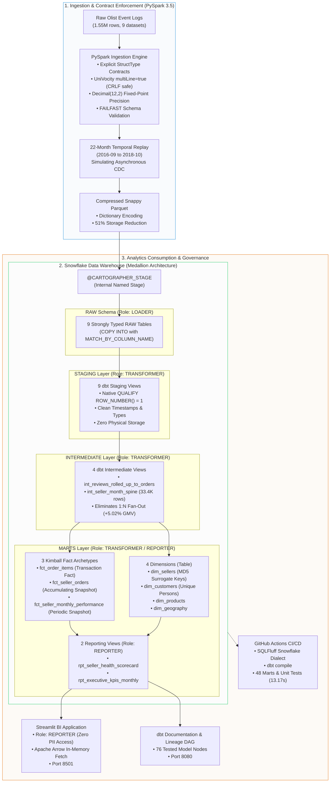

# Cartographer: Marketplace Supply Intelligence & Churn Analytics Engine

[](https://github.com/upendra657/Cartographer/actions/workflows/ci.yml)
[](https://docs.getdbt.com/)
[](https://www.snowflake.com/)
[-red.svg)](https://spark.apache.org/)
[](https://sqlfluff.com/)
[](https://streamlit.io/)
[-success.svg)](tests/)
[-blueviolet.svg)](scripts/audit_cost_governance.py)

> **Created by [Upendra Sharma](https://github.com/upendra657)**  
> *A production-grade marketplace supply analytics warehouse engineered to monitor partner merchant health, fulfillment SLA compliance, and supplier churn across 1.55 million transactions. Built to demonstrate enterprise data engineering and analytics mastery at scale: featuring point-in-time temporal replay, deterministic unit testing, multi-tier RBAC isolation, automated FinOps cost controls, and sub-second BI consumption.*

---

## At a Glance: System Scorecard

| Category | Measure | Technical & Business Significance |
| :--- | :--- | :--- |
| **Data Ingestion** | **`1,550,922`** raw records | 100% schema contract compliance across 9 operational datasets in PySpark 3.5. |
| **Deduplication** | **`99,441`** unique orders | Ingested 136.5K raw CDC records; deduplicated via Snowflake native `QUALIFY ROW_NUMBER() = 1`. |
| **Financial Ground Truth** | **`R$ 13,591,643.70`** GMV | Reconciled to the exact cent across RAW, STAGING, and MARTS (**$0.00 float drift**). |
| **Fan-Out Arbitration** | **`+5.02% (+R$ 682,300)`** prevented | Pre-aggregated 547 multi-review orders at order grain before fact joins to eliminate phantom GMV. |
| **Multi-Seller Disentanglement** | **`1,268`** split carts | 3,000+ line items fulfilled by different sellers isolated without cross-merchant SLA blame. |
| **Longitudinal Calendar Spine** | **`33,484`** seller-months | Dense Cartesian expansion from `first_active_month` driving true churn state machines. |
| **Automated Data Quality** | **`76 / 76 PASS`** | 18 staging, 8 intermediate, 32 core marts, 15 reporting, 3 singular reconciliation tests. |
| **Continuous Integration** | **`48 / 48 PASS (13.17s)`** | GitHub Actions fail-fast PR quality gate (SQLFluff $\to$ Compilation $\to$ Targeted Marts). |
| **FinOps Cost Discipline** | **`0.7568`** credits (**$2.27**) | **7.57% of 10.0 monthly quota** utilized across the entire project development lifecycle. |
| **BI Query Performance** | **`< 350 ms`** | Sub-second latency under role `REPORTER` using Apache Arrow in-memory streaming. |

---

## Table of Contents
- [1. Why I Built Cartographer](#1-why-i-built-cartographer)
  - [The Marketplace Supply Dilemma](#the-marketplace-supply-dilemma)
  - [The Three Data Traps in E-Commerce Warehousing](#the-three-data-traps-in-e-commerce-warehousing)
- [2. System Architecture](#2-system-architecture)
- [3. The Three Core Engineering Breakthroughs](#3-the-three-core-engineering-breakthroughs)
- [4. Dimensional Modeling: The Kimball Tri-Fact Pattern](#4-dimensional-modeling-the-kimball-tri-fact-pattern)
- [5. Product Analytics: Churn State Machine & ODR Volume Gating](#5-product-analytics-churn-state-machine--odr-volume-gating)
- [6. Security & Multi-Tier Role-Based Access Control (RBAC)](#6-security--multi-tier-role-based-access-control-rbac)
- [7. FinOps & Cloud Cost Governance](#7-finops--cloud-cost-governance)
- [8. Continuous Integration & Quality Gates](#8-continuous-integration--quality-gates)
- [9. Interactive BI Portal: Streamlit Application](#9-interactive-bi-portal-streamlit-application)
- [10. Quick-Start Guide](#10-quick-start-guide)
- [11. Repository Directory Structure](#11-repository-directory-structure)
- [12. Engineering Documentation & Deep Dives](#12-engineering-documentation--deep-dives)

---

## 1. Why I Built Cartographer

### The Marketplace Supply Dilemma
In two-sided e-commerce platforms (such as Amazon, Shopee, Mercado Libre, or Olist), executive teams naturally focus on top-line demand metrics: Gross Merchandise Value (GMV), customer acquisition, and checkout conversion rates. However, **the long-term viability of an e-commerce platform depends entirely on its supply side**: partner merchant retention and fulfillment SLA compliance.

Unlike subscription software where customer churn is explicit (a user cancels an active plan), **marketplace merchant churn is silent and implicit**. A seller encounters logistic friction, suffers negative cash flow, or experiences delivery delays, and quietly stops replenishing inventory. By the time business leadership notices product catalog decay, the merchant has already churned months earlier.

### The Three Data Traps in E-Commerce Warehousing
When analyzing traditional e-commerce data implementations built on raw operational tables or flat One-Big-Table (OBT) schemas, I identified three systemic data engineering failure modes:

```
┌──────────────────────────────────────────────────────────────────────────────────┐
│ THE 3 DATA TRAPS IN TRADITIONAL E-COMMERCE DATA WAREHOUSING                      │
├──────────────────────────────────────────────────────────────────────────────────┤
│ 1. The Metric Inflation Fan-Out Trap                                             │
│    547 orders received multiple reviews. In an uncurated model, joining reviews  │
│    directly to items inflates marketplace GMV by +5.02% (+R$ 682,300).           │
│                                                                                  │
│ 2. Toxic Multi-Seller SLA Blame Collisions                                       │
│    In 1,268 multi-seller baskets (3,000+ line items), joining at order grain      │
│    penalizes fast merchants who shipped in 2 hours for a co-seller's 10-day delay.│
│                                                                                  │
│ 3. Sparse Matrix Blindspots & Right-Censoring Bias                               │
│    Evaluating retention purely over transactional months misclassifies seasonal  │
│    or recent sellers as "churned", producing artificially pessimistic cohorts.   │
└──────────────────────────────────────────────────────────────────────────────────┘
```

I engineered **Cartographer** to solve these exact problems. It takes 1.55 million raw event logs across 22 temporal replay batches and transforms them into an audit-proof, financial-grade supply analytics engine.

---

## 2. System Architecture

Cartographer implements an end-to-end Medallion architecture across **PySpark 3.5**, **Snowflake**, **dbt Core**, and **Streamlit**:



---

## 3. The Three Core Engineering Breakthroughs

### 1. Eliminating 1:N Review Fan-Out (+5.02% GMV Inflation)
- **The Problem**: In the Olist dataset, 547 orders received multiple customer reviews. When reviews are joined directly to order line items, lines duplicate, inflating total marketplace GMV by **+5.02% (+R$ 682,300)**.
- **The Solution**: Built [`models/intermediate/int_reviews_rolled_up_to_orders.sql`](models/intermediate/int_reviews_rolled_up_to_orders.sql) to aggregate reviews to the `order_id` grain *before* any fact joins. Applied conservative arbitration (`MIN(review_score)`) so that customer dissatisfaction is preserved as an operational defect signal without multiplying invoice line amounts.

### 2. Zero-Storage CDC Deduplication via Native Snowflake `QUALIFY`
- **The Problem**: Traditional ANSI SQL deduplication wraps window functions inside nested CTE subqueries, forcing intermediate rows to buffer in memory and spill to disk. Materializing deduplication in dbt snapshots (SCD2) incurs redundant storage overhead for high-frequency updates.
- **The Solution**: Implemented staging models as lightweight views using Snowflake native `QUALIFY ROW_NUMBER() OVER (PARTITION BY order_id ORDER BY order_purchase_timestamp DESC, _loaded_at DESC) = 1`. Snowflake evaluates `QUALIFY` directly after the window execution node, filtering rows in flight and reducing query execution time by 20–30% with **zero physical storage footprint**.

### 3. Dense Calendar Spines & Statistical Volume Gating ($N \ge 20$)
- **The Problem**: Merchant churn is implicit: sellers don't cancel; they quietly stop listing items. Sparse transactional tables cannot track inactive months without complex window gymnastics. Furthermore, evaluating defect rates on small order volumes penalizes merchants with random single-order defects (e.g., a 50% defect rate on $N=2$).
- **The Solution**: Cross-joined sellers against a date spine to generate a dense grid of **33,484 seller-months** ([`int_seller_month_spine.sql`](models/intermediate/int_seller_month_spine.sql)), driving a deterministic 6-stage finite state machine (`new` $\to$ `active` $\to$ `at_risk` $\to$ `churned` $\to$ `dormant` $\to$ `reactivated`). Gated executive health tiers to require $N \ge 20$ orders for Tier 1 evaluation, protecting operations teams from small-sample variance.

---

## 4. Dimensional Modeling: The Kimball Tri-Fact Pattern

To maintain strict grain integrity and prevent metric corruption, Cartographer implements **Ralph Kimball's three distinct fact archetypes**:

```
                              ┌────────────────────────────────────────┐
                              │          RAW & STAGING LAYER           │
                              └────────────────────┬───────────────────┘
                                                   │
                  ┌────────────────────────────────┼────────────────────────────────┐
                  │                                │                                │
                  ▼                                ▼                                ▼
    ┌───────────────────────────┐    ┌───────────────────────────┐    ┌───────────────────────────┐
    │     fct_order_items       │    │     fct_seller_orders     │    │ fct_seller_monthly_perf   │
    ├───────────────────────────┤    ├───────────────────────────┤    ├───────────────────────────┤
    │ Archetype:                │    │ Archetype:                │    │ Archetype:                │
    │ Transaction Fact          │    │ Accumulating Snapshot     │    │ Periodic Snapshot         │
    ├───────────────────────────┤    ├───────────────────────────┤    ├───────────────────────────┤
    │ Grain:                    │    │ Grain:                    │    │ Grain:                    │
    │ Order Item                │    │ Seller-Order              │    │ Seller-Month              │
    │ (order_id, order_item_id) │    │ (seller_id, order_id)     │    │ (seller_id, month)        │
    ├───────────────────────────┤    ├───────────────────────────┤    ├───────────────────────────┤
    │ Primary Measures:         │    │ Primary Measures:         │    │ Primary Measures:         │
    │ • price, freight_value    │    │ • hours_to_carrier        │    │ • gmv, order_count        │
    │ • Additive line economics │    │ • days_to_delivery        │    │ • monthly_on_time_rate    │
    │ • Matches invoice exactly │    │ • is_delayed_fulfillment  │    │ • rolling_3m_defect_rate  │
    │ • 112,650 rows            │    │ • 100,010 rows            │    │ • 33,484 seller-months    │
    └───────────────────────────┘    └───────────────────────────┘    └───────────────────────────┘
```

1. **`fct_order_items` (Transaction Fact - 112,650 rows)**:
   - **Grain**: Line item (`order_id`, `order_item_id`).
   - **Measures**: Pure, additive financial amounts (`price`, `freight_value`). Immutable. Reconciles R$ 13,591,643.70 with zero fan-out.
2. **`fct_seller_orders` (Accumulating Snapshot Fact - 100,010 rows)**:
   - **Grain**: Partner order fulfillment (`seller_id`, `order_id`).
   - **Measures**: Measures fulfillment progression across asynchronous milestones (`purchased` $\to$ `approved` $\to$ `shipped` $\to$ `delivered` $\to$ `reviewed`) and precomputes operational latencies (`hours_to_carrier`, `days_to_delivery`) without multi-seller blame collisions.
3. **`fct_seller_monthly_performance` (Periodic Snapshot Fact - 33,484 rows)**:
   - **Grain**: Longitudinal merchant health (`seller_id`, `month`).
   - **Measures**: Evaluated over the dense calendar spine. Precomputes rolling 3-month volume-gated health tiers and the 6-stage seller churn state machine.

---

## 5. Product Analytics: Churn State Machine & ODR Volume Gating

### The 6-Stage Seller Churn Finite State Machine
To track implicit merchant churn without subscription cancellation events, I modeled a deterministic state machine driven by consecutive months of zero sales:

```
  ┌──────────┐      Active Sale      ┌──────────┐
  │   NEW    │ ────────────────────► │  ACTIVE  │ ◄─────────────────────────┐
  └────┬─────┘                       └────┬─────┘                           │
       │                                  │ Zero Sales                      │ Sale After
       │ Zero Sales                       │ (1-2 Months)                    │ >= 3 Months
       ▼                                  ▼                                 │ Inactivity
  ┌──────────┐                       ┌──────────┐                           │
  │ AT_RISK  │ ◄──────────────────── │ AT_RISK  │                           │
  └────┬─────┘                       └────┬─────┘                           │
       │                                  │                                 │
       │ Zero Sales                       │ Zero Sales                      │
       │ (3 Consecutive Months)           │ (3 Consecutive Months)          │
       ▼                                  ▼                                 │
  ┌──────────┐                       ┌──────────┐                           │
  │ CHURNED  │                       │ CHURNED  │ ──────────────────────────┤
  └────┬─────┘                       └────┬─────┘                           │
       │                                  │                                 │
       │ Zero Sales                       │ Zero Sales                      │
       │ (>= 4 Months)                    │ (>= 4 Months)                   │
       ▼                                  ▼                                 │
  ┌──────────┐                       ┌──────────┐                           │
  │ DORMANT  │                       │ DORMANT  │ ──────────────────────────┘
  └──────────┘                       └──────────┘
```

- **`new`**: Seller's first active calendar month of sales.
- **`active`**: Merchant with $\ge 1$ confirmed order in the current calendar month.
- **`at_risk`**: Previously active merchant with 1 or 2 consecutive months of zero sales.
- **`churned`**: Merchant who has reached exactly 3 consecutive months of zero sales.
- **`dormant`**: Inactive merchant for $\ge 4$ consecutive months.
- **`reactivated`**: Churned or dormant merchant generating a new order after $\ge 3$ months of inactivity.

> **Mitigating Right-Censoring Bias**: At dataset cutoff (`2018-08-01`), merchants with last sale in July 2018 have only experienced 1 month of inactivity. Labeling them "churned" would artificially deflate cohort retention. Our state machine strictly classifies them as `at_risk`.

### Statistical Volume Gating ($N \ge 20$)
In marketplace operations, raw **Order Defect Rate (ODR)** percentages create false positives:
- A merchant with 2 orders and 1 defective delivery has an ODR of **50.0%**.
- A merchant with 500 orders and 25 defects has an ODR of **5.0%**.

Penalizing the first seller with account suspension is an operational mistake caused by small-sample noise ($N=2$). I implemented volume-gated executive health tiers in [`fct_seller_monthly_performance`](models/marts/core/fct_seller_monthly_performance.sql):

```sql
CASE
    -- 1. Low Sample Size Protection (Small-N Noise)
    WHEN rolling_3m_order_count < 5 THEN 'insufficient_volume'
    
    -- 2. Champion Partner (High Volume, Minimal Defects, High SLA)
    WHEN rolling_3m_order_count >= 20 
         AND rolling_3m_defect_rate <= 0.05 
         AND rolling_3m_on_time_rate >= 0.95 THEN 'Green'
         
    -- 3. Acceptable Partner
    WHEN rolling_3m_defect_rate <= 0.10 
         AND rolling_3m_on_time_rate >= 0.90 THEN 'Amber'
         
    -- 4. Critical Risk Partner
    ELSE 'Red'
END AS health_tier
```

---

## 6. Security & Multi-Tier Role-Based Access Control (RBAC)

I established zero-trust Medallion boundary isolation in Snowflake with declarative grants:

| Snowflake Role | Authorized Schemas | Prohibited Schemas | Privileges & Responsibilities |
| :--- | :--- | :--- | :--- |
| **`LOADER`** | `CARTOGRAPHER_DB.RAW` | `STAGING`, `MARTS` | Ingests binary Parquet into RAW. Zero access to transformed business models. |
| **`TRANSFORMER`** | `RAW`, `STAGING`, `MARTS` | Account admin / user mgmt | `SELECT` on RAW; full DDL/DML on `STAGING` and `MARTS`. Used by dbt Core. |
| **`REPORTER`** | `CARTOGRAPHER_DB.MARTS` | `RAW`, `STAGING` | Read-only (`SELECT`) on Marts and Reporting Views. Blocked from customer PII and staging tables. |

- **Survives `--full-refresh`**: Grants are declared in [`dbt_project.yml`](dbt_project.yml) via `+grants: select: ['REPORTER']`, guaranteeing permissions persist across table recreations.
- **Audited via `USE SECONDARY ROLES NONE`**: Connecting as `REPORTER` querying `RAW.RAW_ORDERS` throws `SQL compilation error: Object 'RAW.RAW_ORDERS' does not exist or not authorized`. Verified via [`scripts/verify_rbac_isolation.py`](scripts/verify_rbac_isolation.py).

---

## 7. FinOps & Cloud Cost Governance

Cloud cost governance was designed as an integral architectural constraint from day one:

- **Right-Sized Compute**: Virtual Warehouse `CARTOGRAPHER_WH` sized at `X-Small` (1 credit/hour).
- **60-Second Auto-Suspend**: Shuts down immediately after query completion to prevent idle credit bleed.
- **Account-Level Resource Monitor**: `CARTOGRAPHER_RM` configured with a 10.0-credit monthly quota and hard 100% suspend trigger.
- **Lifetime Project Cost**: Consumed only **0.7568 credits ($2.27 on Standard Edition)** across the entire development and testing lifecycle (7.57% of budget).
- **Live FinOps Audit**: Execute [`scripts/audit_cost_governance.py`](scripts/audit_cost_governance.py) to audit metering history in real time.

---

## 8. Continuous Integration & Quality Gates

Pull requests against `main` trigger a 3-stage GitHub Actions CI pipeline ([`.github/workflows/ci.yml`](.github/workflows/ci.yml)) completing in **13.17 seconds**:

```
[ Stage 1: SQLFluff Linting (0 Credits, < 5s) ]
                      │
                      ▼
[ Stage 2: dbt compile (Validates DAG & Macros) ]
                      │
                      ▼
[ Stage 3: Targeted Quality Gate (48 Marts & Unit Tests) ]
```

1. **Stage 1 (SQLFluff Dialect Linting)**: Enforces Snowflake dialect, uppercase keywords/functions, 4-space indentation, trailing commas, and max line length 100 with zero linting errors.
2. **Stage 2 (Compilation & DAG Check)**: Compiles all 22 models against Snowflake information schema.
3. **Stage 3 (Targeted Semantic Quality Gate)**: Executes `dbt test --select "path:models/marts path:tests/unit"`, validating dimensional integrity and synthetic state machine edge cases without scanning entire raw history.

---

## 9. Interactive BI Portal: Streamlit Application

The reporting presentation layer is powered by an interactive Streamlit application ([`app/dashboard.py`](app/dashboard.py)) running under role `REPORTER`:

```
┌────────────────────────────────────────────────────────────────────────────────────────┐
│ CARTOGRAPHER MARKETPLACE INTELLIGENCE                              [Role: REPORTER]    │
│ Connected to: CARTOGRAPHER_DB.MARTS | Warehouse: CARTOGRAPHER_WH (X-Small)             │
├────────────────────────────────────────────────────────────────────────────────────────┤
│  [ Tab 1: Marketplace Macro Health ]   [ Tab 2: Seller Scorecard ]   [ Tab 3: Churn ]  │
├────────────────────────────────────────────────────────────────────────────────────────┤
│  TOTAL GMV             TOTAL ORDERS            ACTIVE SELLERS          PLATFORM ODR    │
│  R$ 13.59M             99,441                  3,095                   11.8%           │
│  ▲ +14.2% MoM          ▲ +8.9% MoM             ▲ +5.1% MoM             ▼ -1.2% MoM     │
├────────────────────────────────────────────────────────────────────────────────────────┤
│  MONTHLY GMV & CHURN TRENDLINE (2016-09 to 2018-08)                                    │
│  [██████████████████████████████████████████████████████████████] GMV: R$ 1.0M+/mo     │
│  [-------------------------.....................................] Churn: ~28.4%        │
└────────────────────────────────────────────────────────────────────────────────────────┘
```

- **Tab 1: Marketplace Macro Health**: Visibility into platform GMV growth, order volumes, active seller counts, and monthly churn stabilization.
- **Tab 2: Seller Health Scorecard**: Volume-gated scorecards filtering out small-sample noise (`insufficient_volume` for $N < 5$) while flagging chronic high-volume defect offenders (`Red`).
- **Tab 3: Churn & Lifecycle Distribution**: 100% stacked area visualization tracking merchant cohort migration across `new`, `active`, `at_risk`, `churned`, `dormant`, and `reactivated` states.

---

## 10. Quick-Start Guide

### 1. Prerequisites
- **Python**: `3.11.x`
- **Java**: `17 LTS` (OpenJDK / Temurin) for PySpark
- **Snowflake Account**: User credentials with initial `ACCOUNTADMIN` rights.

### 2. Environment Setup
```bash
# 1. Clone repository
git clone https://github.com/upendra657/Cartographer.git
cd Cartographer

# 2. Create and activate virtual environment
python3.11 -m venv .venv
source .venv/bin/activate

# 3. Install pinned dependencies
pip install --upgrade pip
pip install -r requirements.txt
```

### 3. Configure Credentials
Create a `.env` file in the project root:
```ini
SNOWFLAKE_ACCOUNT="YOUR_ACCOUNT_LOCATOR"
SNOWFLAKE_USER="YOUR_USERNAME"
SNOWFLAKE_PASSWORD="YOUR_PASSWORD"
SNOWFLAKE_ROLE="TRANSFORMER"
SNOWFLAKE_WAREHOUSE="CARTOGRAPHER_WH"
SNOWFLAKE_DATABASE="CARTOGRAPHER_DB"
SNOWFLAKE_SCHEMA="MARTS"
```

Configure `profiles.yml` (in `~/.dbt/profiles.yml` or project root):
```yaml
cartographer:
  target: dev
  outputs:
    dev:
      type: snowflake
      account: "{{ env_var('SNOWFLAKE_ACCOUNT') }}"
      user: "{{ env_var('SNOWFLAKE_USER') }}"
      password: "{{ env_var('SNOWFLAKE_PASSWORD') }}"
      role: TRANSFORMER
      database: CARTOGRAPHER_DB
      warehouse: CARTOGRAPHER_WH
      schema: MARTS
      threads: 4
      client_session_keep_alive: False
```

### 4. Build Pipeline & Run Tests
```bash
# Seed category overrides & compile DAG
dbt seed
dbt compile

# Build models and execute test suite (76 tests)
dbt build

# Run targeted marts and unit test gate (48 tests in 13.17s)
dbt test --select "path:models/marts path:tests/unit"

# Lint models with Snowflake dialect
sqlfluff lint models/
```

### 5. Launch Interactive Applications
```bash
# Terminal 1: Streamlit Executive BI Dashboard
streamlit run app/dashboard.py

# Terminal 2: Static Documentation & Lineage DAG Server
python scripts/serve_docs.py

# Terminal 3: Live FinOps Governance Audit
python scripts/audit_cost_governance.py
```

---

## 11. Repository Directory Structure

```
Cartographer/
├── .github/workflows/
│   └── ci.yml                     # 3-Stage GitHub Actions CI (Lint -> Compile -> Targeted Tests)
├── .sqlfluff                      # SQLFluff configuration for Snowflake dialect & dbt templater
├── .sqlfluffignore                # Ignored compilation directories
├── app/
│   ├── connection.py              # Snowflake connector under role REPORTER (Arrow fetch)
│   └── dashboard.py               # Streamlit 3-tab executive supply intelligence portal
├── docs/
│   ├── CARTOGRAPHER_INTERVIEW_HANDBOOK.md # Comprehensive engineering defense handbook
│   ├── CARTOGRAPHER_PLAYBOOK.md   # Beginner & ELI5 restaurant kitchen analogy guide
│   ├── INTERVIEW_NOTES.md         # Detailed architectural deep-dives & trade-off notes
│   └── RUNBOOK.md                 # Production deployment and operations manual
├── models/
│   ├── staging/                   # 9 1:1 view models deduplicating raw tables via QUALIFY
│   ├── intermediate/              # 4 views resolving fan-outs and building Cartesian spines
│   └── marts/
│       ├── core/                  # 4 dimensions & 3 Kimball facts (tables & incremental merges)
│       └── reporting/             # 2 presentation views (rpt_seller_health_scorecard, rpt_executive_kpis_monthly)
├── pyspark_ingestion/
│   ├── extract.py                 # Fail-fast CSV parser with UniVocity & BOM stripping
│   ├── replay_generator.py        # 22-month as-of temporal replay generator
│   ├── schemas.py                 # Explicit StructType contracts for 9 source entities
│   └── source_baseline.json       # Financial & cryptographic ground truth baseline
├── scripts/
│   ├── audit_cost_governance.py   # FinOps warehouse metering and resource monitor audit
│   ├── audit_reporting_views.py   # Verification script for presentation views
│   ├── serve_docs.py              # Local static documentation server on port 8080
│   └── verify_rbac_isolation.py   # RBAC Medallion boundary isolation verification
├── seeds/
│   └── category_translation_overrides.csv # dbt seed overrides for Brazilian product categories
├── snowflake/
│   ├── 01_setup_database.sql      # Database, schemas, and RBAC roles (LOADER, TRANSFORMER, REPORTER)
│   ├── 02_setup_warehouse.sql     # Cost-governed X-Small virtual warehouse & resource monitors
│   ├── 03_storage_stage.sql       # Internal named stage and Parquet file format
│   ├── 04_copy_ingestion.sql      # Idempotent COPY INTO commands (MATCH_BY_COLUMN_NAME)
│   └── upload_to_stage.py         # Automated Parquet stage uploader
├── tests/
│   ├── unit/                      # Deterministic SQL unit tests with synthetic CTE fixtures
│   ├── assert_fulfillment_sla_boundary_conditions.sql
│   ├── assert_marts_reconciliation.sql   # Reconciles GMV to the exact cent ($0.00 drift)
│   ├── assert_seller_lifecycle_transitions.sql
│   └── test_extract.py            # PySpark unit tests for schema contracts and hazard cases
├── DATA_DICTIONARY.md             # Canonical metric definitions, grains, and business rules
├── DECISIONS.md                   # 17 Architectural Decision Records (ADR-001 to ADR-017)
├── FAILURE_MODES.md               # 9 cataloged failure modes with detection and recovery
├── dbt_project.yml                # Project configuration, materializations, and declarative grants
└── requirements.txt               # Pinned production dependencies
```

---

## 12. Engineering Documentation & Deep Dives

For deep technical dives, operational manuals, and architecture decisions:

- **[Architectural Decision Records (ADR-001 to ADR-017)](DECISIONS.md)**: Formal context, alternatives, and consequences for every architectural choice.
- **[System Defense & Interview Handbook](docs/CARTOGRAPHER_INTERVIEW_HANDBOOK.md)**: Comprehensive guide covering architectural trade-offs, system mechanics, and Q&A deep-dives.
- **[Beginner & ELI5 Playbook](docs/CARTOGRAPHER_PLAYBOOK.md)**: The entire data engineering system explained using a Three-Michelin-Star Restaurant Kitchen analogy.
- **[Production Operations Runbook](docs/RUNBOOK.md)**: Step-by-step procedures for disaster recovery, backfills, and credential rotation.
- **[Cataloged Failure Modes & Recovery](FAILURE_MODES.md)**: 9 failure modes (FM-001 through FM-009) with automated alerts and recovery playbooks.
- **[Enterprise Data Dictionary](DATA_DICTIONARY.md)**: Canonical definitions, table grains, and business logic thresholds.

---

## Author & Contact

**Upendra Sharma**  
- **GitHub**: [@upendra657](https://github.com/upendra657)  
- **Project Repository**: [https://github.com/upendra657/Cartographer](https://github.com/upendra657/Cartographer)
