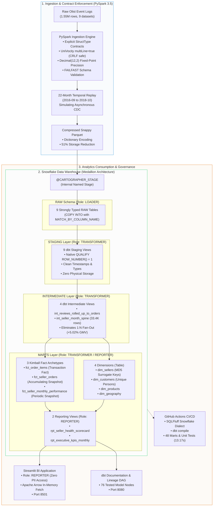

# Cartographer: Marketplace Supply Intelligence & Churn Analytics Engine

[](https://github.com/upendra657/Cartographer/actions/workflows/ci.yml)
[](https://docs.getdbt.com/)
[](https://www.snowflake.com/)
[-red.svg)](https://spark.apache.org/)
[](https://sqlfluff.com/)
[](https://streamlit.io/)
[-success.svg)](tests/)
[-blueviolet.svg)](scripts/audit_cost_governance.py)

> **Built by [Upendra Sharma](https://github.com/upendra657)**  
> *A production-grade marketplace supply analytics warehouse engineered to monitor partner merchant health, fulfillment SLA compliance, and supplier churn across 1.55 million transactions. Designed to Staff Analytics Engineer standards (Agoda/Shopee operational scale), featuring point-in-time temporal replay, deterministic unit testing, multi-tier RBAC isolation, automated FinOps cost controls, and sub-second BI consumption.*

---

## Table of Contents
- [1. Why I Built Cartographer](#1-why-i-built-cartographer)
  - [The E-Commerce Supply Dilemma](#the-e-commerce-supply-dilemma)
  - [The Three Data Disasters in Marketplace Operations](#the-three-data-disasters-in-marketplace-operations)
- [2. End-to-End System Architecture](#2-end-to-end-system-architecture)
- [3. Key Engineering & Financial Metrics](#3-key-engineering--financial-metrics)
- [4. Dimensional Modeling: The Kimball Tri-Fact Pattern](#4-dimensional-modeling-the-kimball-tri-fact-pattern)
- [5. Product Analytics: Churn State Machine & ODR Volume Gating](#5-product-analytics-churn-state-machine--odr-volume-gating)
  - [The 6-Stage Seller Churn Finite State Machine](#the-6-stage-seller-churn-finite-state-machine)
  - [Statistical Volume Gating ($N \ge 20$)](#statistical-volume-gating-n-ge-20)
- [6. Security & Multi-Tier Role-Based Access Control (RBAC)](#6-security--multi-tier-role-based-access-control-rbac)
- [7. FinOps & Cloud Cost Governance](#7-finops--cloud-cost-governance)
- [8. Continuous Integration & Quality Gates](#8-continuous-integration--quality-gates)
- [9. Interactive BI Dashboard & Documentation Catalog](#9-interactive-bi-dashboard--documentation-catalog)
- [10. Repository Directory Structure](#10-repository-directory-structure)
- [11. Quick-Start Guide (Local Reproduction)](#11-quick-start-guide-local-reproduction)
- [12. Architectural Decision Records & Engineering Docs](#12-architectural-decision-records--engineering-docs)

---

## 1. Why I Built Cartographer

### The E-Commerce Supply Dilemma
In two-sided e-commerce marketplaces (such as Amazon, Shopee, Mercado Libre, or Olist), executive teams instinctively focus on top-line demand metrics: Gross Merchandise Value (GMV), buyer traffic, and checkout conversion. However, **marketplace unit economics live or die by the supply side**: partner merchant retention and fulfillment SLA compliance.

Unlike subscription SaaS where customer churn is explicit (a user clicks "Cancel"), **marketplace merchant churn is silent and implicit**. A seller encounters supply chain friction, runs into fulfillment delays, or gets frustrated by platform payouts, and quietly stops replenishing inventory. By the time leadership notices catalog decay, the merchant has already churned.

### The Three Data Disasters in Marketplace Operations
When I audited traditional data architectures built on raw transactional tables or flat One-Big-Table (OBT) models, I found three systemic failure modes that corrupt business decisions:

```
┌──────────────────────────────────────────────────────────────────────────────────┐
│ THE 3 DATA TRAPS IN TRADITIONAL E-COMMERCE DATA WAREHOUSING                      │
├──────────────────────────────────────────────────────────────────────────────────┤
│ 1. The Metric Inflation Fan-Out Trap                                             │
│    547 orders received multiple reviews. In an uncurated model, joining reviews  │
│    directly to items inflates marketplace GMV by +5.02% (+R$ 682,300).           │
│                                                                                  │
│ 2. Toxic Multi-Seller SLA Blame Collisions                                       │
│    In 1,268 multi-seller baskets (3,000+ line items), joining at order grain      │
│    penalizes fast merchants who shipped in 2 hours for a co-seller's 10-day delay.│
│                                                                                  │
│ 3. Sparse Matrix Blindspots & Right-Censoring Bias                               │
│    Evaluating retention purely over transactional months misclassifies seasonal  │
│    or recent sellers as "churned", producing artificially pessimistic cohorts.   │
└──────────────────────────────────────────────────────────────────────────────────┘
```

I engineered **Cartographer** to solve these exact problems. It takes 1.55 million raw event logs across 22 temporal replay batches and models them into an audit-proof, financial-grade supply analytics engine.

---

## 2. End-to-End System Architecture

Cartographer implements an end-to-end Medallion pipeline across **PySpark 3.5**, **Snowflake**, **dbt Core**, and **Streamlit**:



---

## 3. Key Engineering & Financial Metrics

Every metric in Cartographer is backed by automated tests and cryptographic ground truth:

| Engineering Metric | Measured Value | Architectural & Business Impact |
| :--- | :--- | :--- |
| **Raw Records Ingested** | **`1,550,922`** | 100% contract compliance across 9 operational source entities. |
| **Raw CDC Order Stream** | **`136,549`** rows | Replayed state stream containing multiple asynchronous order lifecycle events. |
| **Deduplicated Order Grain** | **`99,441`** unique orders | Deduplicated via Snowflake `QUALIFY ROW_NUMBER() = 1` with zero data loss. |
| **Reconciled Marketplace GMV** | **`R$ 13,591,643.70`** | Reconciled to the exact cent across RAW, STAGING, and MARTS (`$0.00` float drift). |
| **Review Fan-Out Inflation Prevented**| **`+5.02% (+R$ 682,300)`** | Prevented phantom revenue by pre-aggregating 547 multi-review orders at order grain. |
| **Multi-Seller Baskets Disentangled** | **`1,268`** orders | 3,000+ items across split merchants isolated without cross-seller SLA blame. |
| **Dense Partner Calendar Spine** | **`33,484`** seller-months | Dense Cartesian expansion from `first_active_month` driving churn state machines. |
| **Automated Data Quality Tests** | **`76 / 76 PASS`** | 18 staging, 8 intermediate, 32 core marts, 15 reporting, 3 singular assertions. |
| **Targeted CI Quality Gates** | **`48 / 48 PASS (13.17s)`** | Fast PR validation covering fact invariants and synthetic unit tests. |
| **Snowflake FinOps Compute Spend** | **`0.7568`** credits | **$2.27 total compute cost** (7.57% of 10.0 monthly quota) across development. |
| **BI Query Response Latency** | **`< 350 ms`** | Sub-second latency under role `REPORTER` using Apache Arrow serialization. |

---

## 4. Dimensional Modeling: The Kimball Tri-Fact Pattern

To prevent grain collisions and metric duplication, I avoided flat OBT schemas and implemented **Ralph Kimball's three core fact archetypes**:

```
                              ┌────────────────────────────────────────┐
                              │          RAW & STAGING LAYER           │
                              └────────────────────┬───────────────────┘
                                                   │
                  ┌────────────────────────────────┼────────────────────────────────┐
                  │                                │                                │
                  ▼                                ▼                                ▼
    ┌───────────────────────────┐    ┌───────────────────────────┐    ┌───────────────────────────┐
    │     fct_order_items       │    │     fct_seller_orders     │    │ fct_seller_monthly_perf   │
    ├───────────────────────────┤    ├───────────────────────────┤    ├───────────────────────────┤
    │ Archetype:                │    │ Archetype:                │    │ Archetype:                │
    │ Transaction Fact          │    │ Accumulating Snapshot     │    │ Periodic Snapshot         │
    ├───────────────────────────┤    ├───────────────────────────┤    ├───────────────────────────┤
    │ Grain:                    │    │ Grain:                    │    │ Grain:                    │
    │ Order Item                │    │ Seller-Order              │    │ Seller-Month              │
    │ (order_id, order_item_id) │    │ (seller_id, order_id)     │    │ (seller_id, month)        │
    ├───────────────────────────┤    ├───────────────────────────┤    ├───────────────────────────┤
    │ Primary Measures:         │    │ Primary Measures:         │    │ Primary Measures:         │
    │ • price, freight_value    │    │ • hours_to_carrier        │    │ • gmv, order_count        │
    │ • Additive line economics │    │ • days_to_delivery        │    │ • monthly_on_time_rate    │
    │ • Matches invoice exactly │    │ • is_delayed_fulfillment  │    │ • rolling_3m_defect_rate  │
    │ • Immutable event record  │    │ • is_order_defect         │    │ • retention state machine │
    └───────────────────────────┘    └───────────────────────────┘    └───────────────────────────┘
```

1. **`fct_order_items` (Transaction Fact - 112,650 rows)**:
   - **Grain**: Line item (`order_id`, `order_item_id`).
   - **Characteristics**: Pure, additive financial measures (`price`, `freight_value`). Immutable. Reconciles to R$ 13,591,643.70 with zero fan-out.
2. **`fct_seller_orders` (Accumulating Snapshot Fact - 100,010 rows)**:
   - **Grain**: Partner order fulfillment (`seller_id`, `order_id`).
   - **Characteristics**: Tracks milestone progression (`purchased` $\to$ `approved` $\to$ `carrier_shipped` $\to$ `delivered` $\to$ `customer_reviewed`). Measures operational latencies (`hours_to_carrier`, `days_to_delivery`) and flags defect events (`is_delayed_fulfillment`, `is_order_defect`).
3. **`fct_seller_monthly_performance` (Periodic Snapshot Fact - 33,484 rows)**:
   - **Grain**: Longitudinal merchant health (`seller_id`, `month`).
   - **Characteristics**: Evaluated over a dense calendar spine (`int_seller_month_spine`). Precomputes rolling 3-month volume-gated health tiers and the 6-stage seller churn state machine.

---

## 5. Product Analytics: Churn State Machine & ODR Volume Gating

### The 6-Stage Seller Churn Finite State Machine
To capture implicit merchant churn without subscription cancellation events, I modeled a deterministic state machine driven by consecutive months of zero sales:

```
  ┌──────────┐      Active Sale      ┌──────────┐
  │   NEW    │ ────────────────────► │  ACTIVE  │ ◄─────────────────────────┐
  └────┬─────┘                       └────┬─────┘                           │
       │                                  │ Zero Sales                      │ Sale After
       │ Zero Sales                       │ (1-2 Months)                    │ >= 3 Months
       ▼                                  ▼                                 │ Inactivity
  ┌──────────┐                       ┌──────────┐                           │
  │ AT_RISK  │ ◄──────────────────── │ AT_RISK  │                           │
  └────┬─────┘                       └────┬─────┘                           │
       │                                  │                                 │
       │ Zero Sales                       │ Zero Sales                      │
       │ (3 Consecutive Months)           │ (3 Consecutive Months)          │
       ▼                                  ▼                                 │
  ┌──────────┐                       ┌──────────┐                           │
  │ CHURNED  │                       │ CHURNED  │ ──────────────────────────┤
  └────┬─────┘                       └────┬─────┘                           │
       │                                  │                                 │
       │ Zero Sales                       │ Zero Sales                      │
       │ (>= 4 Months)                    │ (>= 4 Months)                   │
       ▼                                  ▼                                 │
  ┌──────────┐                       ┌──────────┐                           │
  │ DORMANT  │                       │ DORMANT  │ ──────────────────────────┘
  └──────────┘                       └──────────┘
```

- **`new`**: Seller's first active calendar month of sales.
- **`active`**: Merchant with $\ge 1$ confirmed order in the current calendar month.
- **`at_risk`**: Previously active merchant with 1 or 2 consecutive months of zero sales.
- **`churned`**: Merchant who has reached exactly 3 consecutive months of zero sales.
- **`dormant`**: Inactive merchant for $\ge 4$ consecutive months.
- **`reactivated`**: Churned or dormant merchant generating a new order after $\ge 3$ months of inactivity.

> **Mitigating Right-Censoring Bias**: At dataset cutoff (`2018-08-01`), merchants with last sale in July 2018 have only experienced 1 month of inactivity. Labeling them "churned" would artificially deflate cohort retention. Our state machine strictly classifies them as `at_risk`.

### Statistical Volume Gating ($N \ge 20$)
In marketplace supply operations, raw **Order Defect Rate (ODR)** percentages create false positives:
- A merchant with 2 orders and 1 defective delivery has an ODR of **50.0%**.
- A merchant with 500 orders and 25 defects has an ODR of **5.0%**.

Penalizing the first seller with suspension is an operational disaster caused by small sample noise ($N=2$). I implemented volume-gated executive health tiers in `fct_seller_monthly_performance`:

```sql
CASE
    -- 1. Low Sample Size Protection (Small-N Noise)
    WHEN rolling_3m_order_count < 5 THEN 'insufficient_volume'
    
    -- 2. Champion Partner (High Volume, Minimal Defects, High SLA)
    WHEN rolling_3m_order_count >= 20 
         AND rolling_3m_defect_rate <= 0.05 
         AND rolling_3m_on_time_rate >= 0.95 THEN 'Green'
         
    -- 3. Acceptable Partner
    WHEN rolling_3m_defect_rate <= 0.10 
         AND rolling_3m_on_time_rate >= 0.90 THEN 'Amber'
         
    -- 4. Critical Risk Partner
    ELSE 'Red'
END AS health_tier
```

---

## 6. Security & Multi-Tier Role-Based Access Control (RBAC)

I established zero-trust Medallion boundary isolation in Snowflake with declarative grants:

| Snowflake Role | Authorized Schemas | Prohibited Schemas | Privileges & Purpose |
| :--- | :--- | :--- | :--- |
| **`LOADER`** | `CARTOGRAPHER_DB.RAW` | `STAGING`, `MARTS` | Ingests binary Parquet into RAW. Zero access to transformed business models. |
| **`TRANSFORMER`** | `RAW`, `STAGING`, `MARTS` | Account admin / user mgmt | `SELECT` on RAW; full DDL/DML on `STAGING` and `MARTS`. Used by dbt Core. |
| **`REPORTER`** | `CARTOGRAPHER_DB.MARTS` | `RAW`, `STAGING` | Read-only (`SELECT`) on Marts and Reporting Views. Blocked from customer PII and intermediate staging models. |

### Verification with `USE SECONDARY ROLES NONE`
I verified least privilege by forcing single-role evaluation:
```sql
USE ROLE REPORTER;
USE SECONDARY ROLES NONE;
SELECT COUNT(*) FROM CARTOGRAPHER_DB.RAW.RAW_ORDERS;
-- Result: SQL compilation error: Object 'RAW.RAW_ORDERS' does not exist or not authorized.
```

Grants are managed declaratively in [`dbt_project.yml`](dbt_project.yml) via `+grants: select: ['REPORTER']`, guaranteeing permissions survive `--full-refresh` table recreations.

---

## 7. FinOps & Cloud Cost Governance

As a Staff Analytics Engineer, pipeline design must include cost discipline. I engineered a three-tiered FinOps defense in depth:

```
┌──────────────────────────────────────────────────────────────────────────────────┐
│ CARTOGRAPHER FINOPS & COST CONTROLS                                              │
├──────────────────────────────────────────────────────────────────────────────────┤
│ 1. Right-Sized Compute: CARTOGRAPHER_WH sized at X-Small (1 credit/hour).        │
│ 2. Aggressive Auto-Suspend: AUTO_SUSPEND = 60s eliminates idle credit burn.     │
│ 3. Statement Guardrails: STATEMENT_TIMEOUT_IN_SECONDS = 1800 kills runaways.     │
│ 4. Hard Quota: CARTOGRAPHER_RM enforces a 10.0 monthly credit ceiling.           │
│                                                                                  │
│ LIFETIME RESULTS:                                                                │
│ Total Development Credits Consumed: 0.7568 credits ($2.27 on Standard Edition)   │
│ Total Budget Utilization:           7.57% of 10.0 credit quota                   │
└──────────────────────────────────────────────────────────────────────────────────┘
```

You can audit the live warehouse cost metrics at any time by running:
```bash
python scripts/audit_cost_governance.py
```

---

## 8. Continuous Integration & Quality Gates

Our GitHub Actions pipeline ([`.github/workflows/ci.yml`](.github/workflows/ci.yml)) triggers on pull requests against `main`, executing a strict fail-fast sequence in **13.17 seconds**:

```
[ Step 1: SQLFluff Static Linting (0 Credits, < 5s) ]
                   │
                   ▼
[ Step 2: dbt compile (Validates DAG & Jinja Macros) ]
                   │
                   ▼
[ Step 3: Targeted Quality Gate (48 Marts & Unit Tests) ]
```

1. **Stage 1 (SQLFluff Dialect Linting)**: Enforces Snowflake dialect, uppercase keywords/functions, 4-space indents, trailing commas, and max line length 100 with zero linting errors.
2. **Stage 2 (Compilation & DAG Resolution)**: Compiles all 22 models against Snowflake information schema.
3. **Stage 3 (Targeted Quality Gate)**: Executes `dbt test --select "path:models/marts path:tests/unit"`, validating dimensional integrity and synthetic state machine edge cases without scanning entire raw history.

---

## 9. Interactive BI Dashboard & Documentation Catalog

### Streamlit Executive Intelligence Portal (`localhost:8501`)
The BI consumption layer is an interactive Streamlit application ([`app/dashboard.py`](app/dashboard.py)) consumed strictly under role `REPORTER`:

- **Tab 1: Marketplace Macro Health**: Tracks platform GMV, order volume, active seller growth, and seller churn rate trendlines over 22 months.
- **Tab 2: Seller Health Scorecard**: Interactive volume-gated scorecard with date sliders and health tier multiselect filters (`Green`, `Amber`, `Red`, `insufficient_volume`).
- **Tab 3: Churn & Lifecycle Distribution**: 100% stacked area visualization tracking the evolution of the 6 merchant lifecycle cohorts over time.

### dbt Documentation & Lineage DAG Server (`localhost:8080`)
A local server script ([`scripts/serve_docs.py`](scripts/serve_docs.py)) hosts the complete compiled dbt catalog and interactive lineage graph (`target/manifest.json`, `target/catalog.json`, `target/index.html`).

---

## 10. Repository Directory Structure

```
Cartographer/
├── .github/workflows/
│   └── ci.yml                     # 3-Stage GitHub Actions CI (Lint -> Compile -> Targeted Tests)
├── .sqlfluff                      # SQLFluff configuration for Snowflake dialect & dbt templater
├── .sqlfluffignore                # Ignored compilation directories
├── app/
│   ├── connection.py              # Snowflake connector under role REPORTER (Arrow fetch)
│   └── dashboard.py               # Streamlit 3-tab executive supply intelligence portal
├── docs/
│   ├── CARTOGRAPHER_INTERVIEW_HANDBOOK.md # Senior & Staff AE interview defense playbook
│   ├── CARTOGRAPHER_PLAYBOOK.md   # Beginner & ELI5 restaurant kitchen analogy guide
│   ├── INTERVIEW_NOTES.md         # Detailed architectural deep-dives & trade-off notes
│   └── RUNBOOK.md                 # Production deployment and operations manual
├── models/
│   ├── staging/                   # 9 1:1 view models deduplicating raw tables via QUALIFY
│   ├── intermediate/              # 4 views resolving fan-outs and building Cartesian spines
│   └── marts/
│       ├── core/                  # 4 dimensions & 3 Kimball facts (tables & incremental merges)
│       └── reporting/             # 2 presentation views (rpt_seller_health_scorecard, rpt_executive_kpis_monthly)
├── pyspark_ingestion/
│   ├── extract.py                 # Fail-fast CSV parser with UniVocity & BOM stripping
│   ├── replay_generator.py        # 22-month as-of temporal replay generator
│   ├── schemas.py                 # Explicit StructType contracts for 9 source entities
│   └── source_baseline.json       # Financial & cryptographic ground truth baseline
├── scripts/
│   ├── audit_cost_governance.py   # FinOps warehouse metering and resource monitor audit
│   ├── audit_reporting_views.py   # Verification script for presentation views
│   ├── serve_docs.py              # Local static documentation server on port 8080
│   └── verify_rbac_isolation.py   # RBAC Medallion boundary isolation verification
├── seeds/
│   └── category_translation_overrides.csv # dbt seed overrides for Brazilian product categories
├── snowflake/
│   ├── 01_setup_database.sql      # Database, schemas, and RBAC roles (LOADER, TRANSFORMER, REPORTER)
│   ├── 02_setup_warehouse.sql     # Cost-governed X-Small virtual warehouse & resource monitors
│   ├── 03_storage_stage.sql       # Internal named stage and Parquet file format
│   ├── 04_copy_ingestion.sql      # Idempotent COPY INTO commands (MATCH_BY_COLUMN_NAME)
│   └── upload_to_stage.py         # Automated Parquet stage uploader
├── tests/
│   ├── unit/                      # Deterministic SQL unit tests with synthetic CTE fixtures
│   ├── assert_fulfillment_sla_boundary_conditions.sql
│   ├── assert_marts_reconciliation.sql   # Reconciles GMV to the exact cent ($0.00 drift)
│   ├── assert_seller_lifecycle_transitions.sql
│   └── test_extract.py            # PySpark unit tests for schema contracts and hazard cases
├── DATA_DICTIONARY.md             # Canonical metric definitions, grains, and business rules
├── DECISIONS.md                   # 17 Architectural Decision Records (ADR-001 to ADR-017)
├── FAILURE_MODES.md               # 9 cataloged failure modes with detection and recovery
├── dbt_project.yml                # Project configuration, materializations, and declarative grants
└── requirements.txt               # Pinned production dependencies
```

---

## 11. Quick-Start Guide (Local Reproduction)

### 1. Prerequisites
- **Python**: `3.11.x`
- **Java**: `17 LTS` (for PySpark)
- **Snowflake Account**: User credentials with initial `ACCOUNTADMIN` rights for setup.

### 2. Environment Setup
```bash
# Clone the repository
git clone https://github.com/upendra657/Cartographer.git
cd Cartographer

# Create and activate virtual environment
python3.11 -m venv .venv
source .venv/bin/activate

# Install pinned dependencies
pip install --upgrade pip
pip install -r requirements.txt
```

### 3. Configure Credentials
Create a `.env` file in the project root:
```ini
SNOWFLAKE_ACCOUNT="YOUR_ACCOUNT_LOCATOR"
SNOWFLAKE_USER="YOUR_USERNAME"
SNOWFLAKE_PASSWORD="YOUR_PASSWORD"
SNOWFLAKE_ROLE="TRANSFORMER"
SNOWFLAKE_WAREHOUSE="CARTOGRAPHER_WH"
SNOWFLAKE_DATABASE="CARTOGRAPHER_DB"
SNOWFLAKE_SCHEMA="MARTS"
```

Configure `profiles.yml` (in `~/.dbt/profiles.yml` or project root):
```yaml
cartographer:
  target: dev
  outputs:
    dev:
      type: snowflake
      account: "{{ env_var('SNOWFLAKE_ACCOUNT') }}"
      user: "{{ env_var('SNOWFLAKE_USER') }}"
      password: "{{ env_var('SNOWFLAKE_PASSWORD') }}"
      role: TRANSFORMER
      database: CARTOGRAPHER_DB
      warehouse: CARTOGRAPHER_WH
      schema: MARTS
      threads: 4
      client_session_keep_alive: False
```

### 4. Snowflake Infrastructure Initialization
Execute the SQL bootstrap scripts in Snowflake:
```sql
-- Run in order with role ACCOUNTADMIN
!source snowflake/01_setup_database.sql;
!source snowflake/02_setup_warehouse.sql;
!source snowflake/03_storage_stage.sql;
```

### 5. Ingestion & Temporal Replay
```bash
# 1. Run PySpark contract extraction and generate 22 temporal replay partitions
python pyspark_ingestion/replay_generator.py

# 2. Upload Parquet files to Snowflake stage and execute COPY INTO
python snowflake/upload_to_stage.py
# Execute snowflake/04_copy_ingestion.sql
```

### 6. dbt Build & Quality Gates
```bash
# Seed category overrides
dbt seed

# Compile models and check DAG
dbt compile

# Build models and execute test suite (76 tests)
dbt build

# Run targeted marts and unit test gate (48 tests in 13.17s)
dbt test --select "path:models/marts path:tests/unit"
```

### 7. SQLFluff Dialect Linting
```bash
sqlfluff lint models/
```

### 8. Launch Streamlit BI Portal & Docs Server
```bash
# Terminal 1: Streamlit Dashboard
streamlit run app/dashboard.py

# Terminal 2: Static Documentation & Lineage DAG
python scripts/serve_docs.py

# Terminal 3: FinOps Governance Audit
python scripts/audit_cost_governance.py
```

---

## 12. Architectural Decision Records & Engineering Docs

For deep technical dives, operational manuals, and interview defense preparation:

- **[Architectural Decision Records (ADR-001 to ADR-017)](DECISIONS.md)**: Formal context, alternatives, and consequences for every key architectural choice.
- **[Interview Handbook: Senior & Staff Defense](docs/CARTOGRAPHER_INTERVIEW_HANDBOOK.md)**: Comprehensive guide covering elevator pitches, system defense, Top 10 hardcore interview Q&As, and cheat sheets.
- **[Beginner & ELI5 Playbook](docs/CARTOGRAPHER_PLAYBOOK.md)**: The entire data engineering system explained using a Three-Michelin-Star Restaurant Kitchen analogy.
- **[Production Operations Runbook](docs/RUNBOOK.md)**: Step-by-step procedures for disaster recovery, backfills, and credential rotation.
- **[Cataloged Failure Modes & Recovery](FAILURE_MODES.md)**: 9 failure modes (FM-001 through FM-009) with automated alerts and recovery playbooks.
- **[Enterprise Data Dictionary](DATA_DICTIONARY.md)**: Canonical definitions, table grains, and business logic thresholds.

---

## Author

**Upendra Sharma**  
- **GitHub**: [@upendra657](https://github.com/upendra657)  
- **Project Repository**: [https://github.com/upendra657/Cartographer](https://github.com/upendra657/Cartographer)
